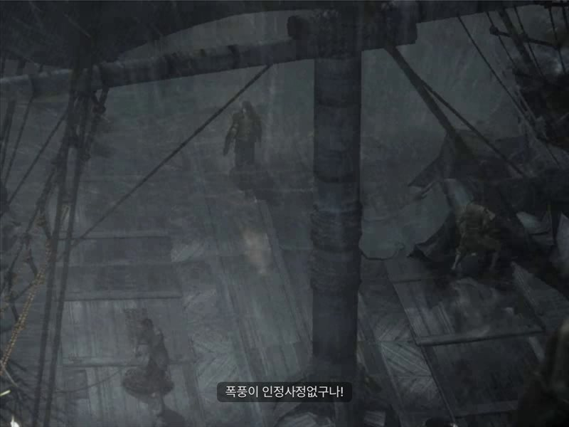
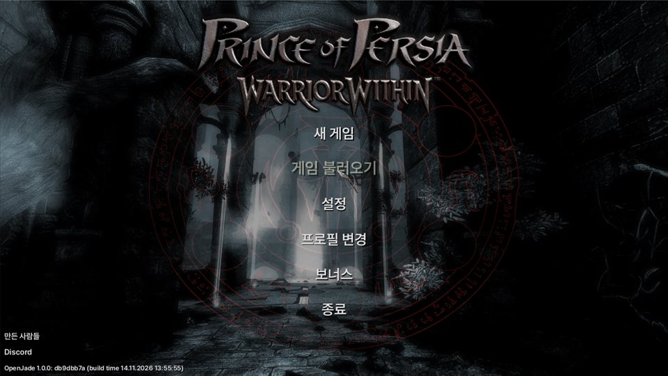
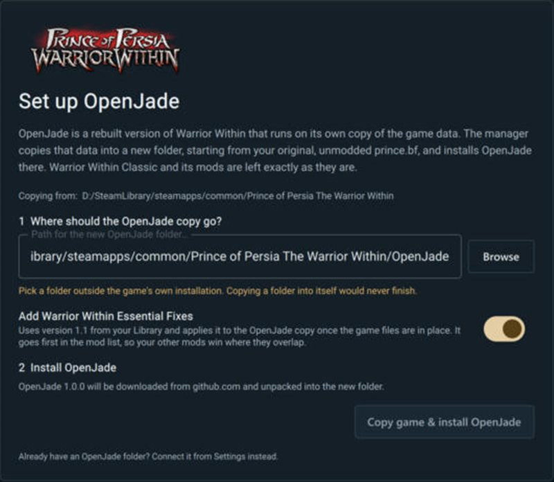
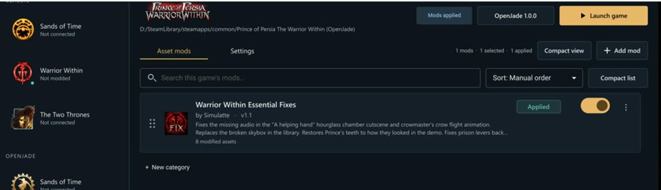
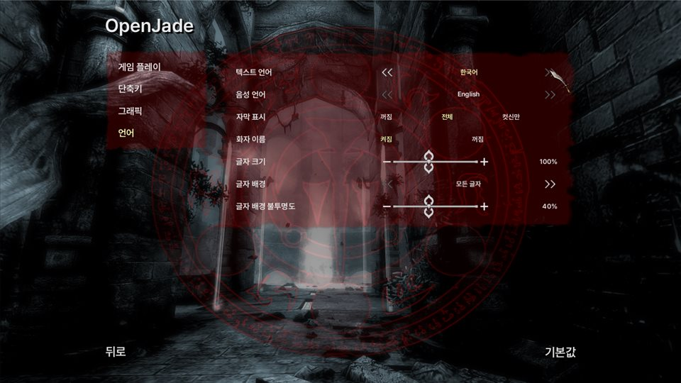
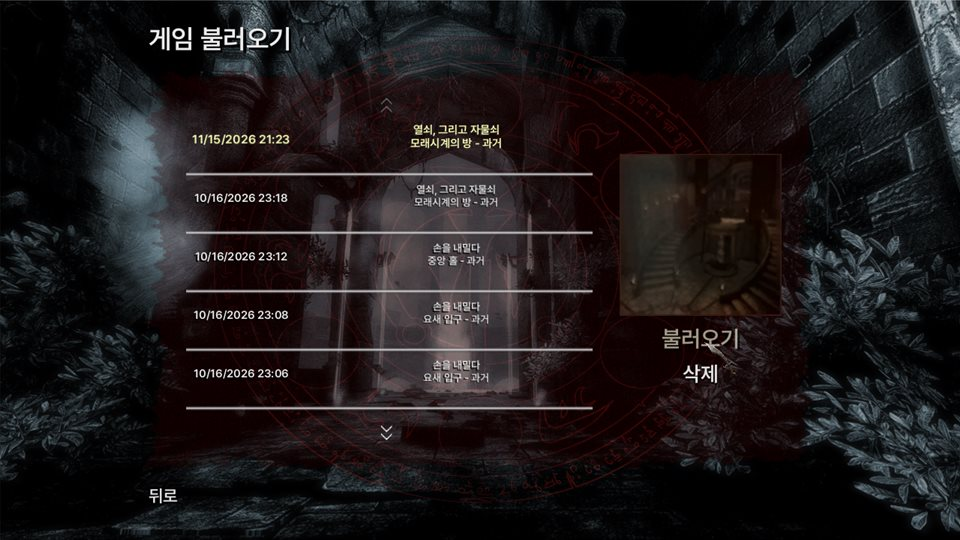

# 페르시아의 왕자: 전사의 길 한글 패치 (OpenJade판)

**Prince of Persia: The Warrior Within — Korean language pack for OpenJade**

> **v1.0** · 한글화: **슬램백호**
> 어색한 번역, 오역, 깨지는 글자를 발견하시면 [이슈](../../issues)로 알려 주세요.

<p align="center">
  
  
</p>

[OpenJade](https://github.com/dekamaru/openjade)는 원작 게임 파일을 그대로 읽어 실행하는 '페르시아의 왕자' 3부작 엔진 재구현입니다. 이 팩은 OpenJade에서 '전사의 길'을 한국어로 즐길 수 있게 해 주는 **언어 팩**입니다. 게임 파일은 건드리지 않고, OpenJade의 `Languages` 폴더에 한국어를 추가합니다.

같은 방식의 한글 패치: [시간의 모래](https://github.com/slam64/PoPSoT-Korean-Patch) · [두 개의 왕좌](https://github.com/slam64/PoPT2T-Korean-Patch)

## 목차

- [다운로드](#다운로드)
- [이 패치의 특징](#이-패치의-특징)
- [준비물](#준비물)
- [처음 설치하는 분을 위한 가이드](#처음-설치하는-분을-위한-가이드)
- [게임을 더 편하게 즐기는 팁](#게임을-더-편하게-즐기는-팁)
- [문제 해결](#문제-해결)
- [업데이트와 제거](#업데이트와-제거)
- [설치 프로그램이 하는 일 / 직접 설치](#설치-프로그램이-하는-일)
- [클래식판(v0.9.x) 안내](#클래식판v09x-안내)
- [바뀐 내용](#바뀐-내용) · [만든 사람과 고마운 분들](#만든-사람과-고마운-분들)

## 다운로드

[**Releases**](../../releases/latest)에서 `PoPWW_Korean_OpenJade_v1.0.zip`을 받으세요.

> 저장소 맨 위의 `INSTALL.bat`, `patcher/` 폴더는 원래 실행 파일용 **클래식판** 설치 프로그램입니다. OpenJade판은 반드시 Releases의 zip을 받으세요.

## 이 패치의 특징

- **완전 한글화** — 메뉴, 설정, 저장/불러오기, 튜토리얼, 대화와 영상 자막, OpenJade 전용 메뉴까지 한국어로 옮겼습니다. 영어 원문에 충실하면서도 인물마다 말투를 살린 자연스러운 구어체입니다.
- **원작에 없던 음성 자막** — 원래 자막이 없어 영어로만 들리던 음성(왕자의 혼잣말, 보스와 주요 인물의 대사 등)에도 자막을 붙였습니다.
- **깔끔한 글꼴** — 한글은 [Pretendard](https://github.com/orioncactus/pretendard)(SIL OFL)로 표시합니다.
- **게임 파일을 건드리지 않음** — 그래서 PoP Mod Manager의 **Warrior Within Essential Fixes**, **4K 텍스처 팩**과 함께 쓸 수 있습니다(둘 다 함께 쓰는 것을 확인했습니다).
- **안전한 설치** — `INSTALL.bat` 한 번으로 설치하고, `UNINSTALL.bat`으로 설치 전 상태로 되돌립니다. `settings.ini`의 다른 설정은 건드리지 않습니다.

## 준비물

| 준비물 | 설명 |
|---|---|
| **페르시아의 왕자: 전사의 길** PC판 | Steam판(영어)으로 확인했습니다. |
| **PoP Mod Manager** (무료) | OpenJade 설치와 원작 버그 수정 모드를 한 번에 처리합니다. [GitHub](https://github.com/kaminoer/PoP-Mod-Manager/releases) |
| **4K 텍스처 팩** (선택, 무료) | Nexus Mods 계정(무료)이 있어야 받을 수 있습니다. [Nexus Mods](https://www.nexusmods.com/princeofpersiawarriorwithin/mods/38) |
| Windows 10/11 64비트 | |

**디스크 공간:** 원래 게임 외에 OpenJade용 게임 사본 약 3.3GB + PoP Mod Manager의 원본 백업 약 1.3GB + (4K 팩을 쓰면) 약 6.1GB가 더 필요합니다.

## 처음 설치하는 분을 위한 가이드

전체 순서: **Steam 게임 설치 → PoP Mod Manager로 OpenJade 설치 → (선택) 4K 텍스처 → 한국어 팩 → Steam 실행 설정 → 실행**

아래 예시는 Steam 라이브러리가 `D:\SteamLibrary`인 경우입니다. 본인 PC의 경로로 바꿔 읽어 주세요.

### 1단계. Steam에서 게임 설치

1. Steam에서 **Prince of Persia: The Warrior Within**을 설치합니다.
   - 예: `D:\SteamLibrary\steamapps\common\Prince of Persia The Warrior Within`
2. 원래 실행 파일용 다른 한글 패치나 모드를 설치한 적이 있다면, 먼저 Steam에서 **게임 우클릭 → 속성 → 설치된 파일 → 게임 파일 무결성 확인**으로 원본 상태로 되돌려 두세요. OpenJade는 원본 게임 파일로 쓰는 것이 좋습니다.

> 💡 OpenJade는 이 폴더를 **복사해서** 따로 설치됩니다. 원래 게임 폴더는 그대로 남으므로, 원래 게임(클래식)도 계속 실행할 수 있습니다.

### 2단계. PoP Mod Manager(PMM) 받기

1. [PoP Mod Manager Releases](https://github.com/kaminoer/PoP-Mod-Manager/releases)에서 최신 zip(예: `PoP.Mod.Manager.v2.1.3.zip`)을 받습니다.
2. 원하는 곳에 압축을 풉니다. 예: `D:\Games\PoPModManager`
   - `C:\Program Files`처럼 쓰기 권한이 필요한 곳은 피하세요.
3. 압축을 푼 폴더 **바로 안의** `PoPModManager.exe`를 실행합니다.
   - `app` 폴더 안에도 같은 이름의 파일이 있지만, 바깥 것이 업데이트를 적용한 뒤 실행해 주는 실행기입니다. 바로 가기를 만든다면 바깥 것으로 만드세요.

### 3단계. PMM 처음 설정과 원래 게임 연결

1. 처음 실행하면 **Choose where to keep your data** 화면이 나옵니다. **비어 있는 새 폴더**를 고르세요(예: `D:\Games\PoPModManager\data`).
   - 원본 `prince.bf` 백업(원래 게임용과 OpenJade용 두 개, 합쳐서 약 1.3GB)과 모드 목록이 여기에 저장됩니다. 지우지 마세요.
2. `.jtmod` 파일 연결을 물으면 아무 쪽이나 골라도 됩니다.
3. 왼쪽 목록 위쪽의 **Warrior Within**(원래 게임)을 누르고, 게임 폴더에 Steam 게임 폴더를 지정한 뒤 **Back up & connect**를 누릅니다.
   - PMM이 원본 `prince.bf`를 백업하고 게임을 연결합니다. 원래 게임 파일은 바뀌지 않습니다.

### 4단계. OpenJade 설치 (원작 버그 수정 포함)

1. 왼쪽 목록 아래쪽 **OPENJADE** 항목의 **Warrior Within**을 누르면 **Set up OpenJade** 화면이 나옵니다. 목록이 길면 조금 내려야 보입니다.
2. **1 Where should the OpenJade copy go?** — OpenJade를 설치할 폴더입니다.
   - PMM이 제안하는 기본 경로를 그대로 쓰는 것을 추천합니다: `D:\SteamLibrary\steamapps\common\Prince of Persia The Warrior Within (OpenJade)`
   - ⚠️ **원래 게임 폴더 안쪽**(예: `...\Prince of Persia The Warrior Within\OpenJade`)은 고를 수 없습니다. 주황색 경고 *"Pick a folder outside the game's own installation"*이 뜨고 설치 버튼이 켜지지 않습니다.

   <p align="center"></p>

3. **Add Warrior Within Essential Fixes**는 **켜 둔 채로** 둡니다. PMM 제작자가 만든 OpenJade용 원작 버그 수정 모음입니다.
   - 모래시계 방 영상 뒤 대사 음성이 나오지 않는 문제, 왕자의 치아, 도서관 하늘 배경, 까마귀 조련사의 비행 동작, 감옥 레버를 고칩니다.
4. **Copy game & install OpenJade**를 누릅니다. 게임 데이터를 복사하고, GitHub에서 OpenJade 1.0.0을 받아 설치한 뒤 Essential Fixes까지 적용합니다(1~2분).
5. 끝나면 이런 화면이 됩니다. 위쪽에 **Mods applied**, **OpenJade 1.0.0**, 목록에 **Warrior Within Essential Fixes — Applied**가 보이면 성공입니다.

   <p align="center"></p>

> 💡 PMM은 설치할 때 원래 게임 폴더의 세이브(`POPWWProfiles`)도 같이 복사합니다. 원래 게임으로 하던 진행을 OpenJade에서 이어서 할 수 있고, 그 뒤로 두 쪽의 세이브는 따로 저장됩니다.

### 5단계. (선택) 4K 텍스처 팩

1. [PoPWW 4K Texture Pack](https://www.nexusmods.com/princeofpersiawarriorwithin/mods/38) 페이지의 **Files** 탭에서 두 가지를 받습니다.
   - **메인 파일**: 그 안의 `Evgesha.JK`(약 6.1GB)
   - **선택 파일 "Texture support in OpenJade"**: 그 안의 `iphlpapi.dll`
2. 두 파일을 OpenJade 폴더(`...\Prince of Persia The Warrior Within (OpenJade)`)에 넣습니다.
   - 메인 파일의 `d3d9.dll`은 원래 게임용입니다. OpenJade에는 필요 없습니다.
3. 4K 팩은 재업로드가 허락되지 않으니 반드시 원 배포처에서 받아 주세요.

### 6단계. 한국어 팩 설치

1. [Releases](../../releases/latest)에서 받은 `PoPWW_Korean_OpenJade_v1.0.zip`을 **아무 곳에나** 풉니다.
   - OpenJade 폴더 안에 풀어도 됩니다. 그러면 설치 프로그램이 그 폴더를 바로 씁니다.
2. 게임이 꺼진 상태에서 **`INSTALL.bat`**을 실행합니다.
   - OpenJade 폴더를 자동으로 찾습니다(Steam 라이브러리, PMM 설정). 여러 곳에서 찾으면 번호를 고르고, 못 찾으면 폴더를 고르는 창이 뜹니다.
   - "Windows의 PC 보호" 창이 뜨면 **추가 정보 → 실행**을 누르세요.
3. 마지막에 나오는 **Steam 실행 옵션 줄**을 복사해 두세요. 7단계에서 씁니다.

```
"D:\SteamLibrary\steamapps\common\Prince of Persia The Warrior Within (OpenJade)\launch_openjade.bat" %command%
```

### 7단계. Steam에서 OpenJade로 실행하기

Steam의 **[플레이]** 버튼은 원래 게임을 실행합니다. Steam에서 OpenJade를 실행하려면:

1. Steam 라이브러리 → 게임 우클릭 → **속성** → **일반** → **실행 옵션**
2. 6단계에서 복사한 줄을 붙여 넣습니다.
3. 이제 **[플레이]**를 누르면 OpenJade가 실행됩니다.

- 실행 옵션을 비우면 다시 원래 게임이 실행됩니다.
- Steam에서 실행하면 검은 명령 창이 함께 뜰 수 있습니다. OpenJade를 실행해 주는 `launch_openjade.bat`의 창이며, 게임을 끝내면 함께 닫힙니다.
- Steam 말고도 **PMM의 Launch game** 버튼이나, OpenJade 폴더의 `launch_openjade.bat`을 더블클릭해서 실행할 수 있습니다.

### 8단계. 처음 실행하고 확인하기

1. 로고 영상 뒤 프로필을 고르거나 새로 만들면 메인 메뉴가 **한국어**로 나옵니다.
2. **설정 → 그래픽**에서 해상도와 전체 화면을 맞추세요. OpenJade 전용 그래픽 설정은 **설정 → OpenJade → 그래픽**에 있습니다.
3. **설정 → OpenJade → 언어**에서 자막과 글자 크기를 취향에 맞게 조절합니다.

<p align="center">
  
  
</p>

설치 끝! 즐거운 플레이 되세요.

## 게임을 더 편하게 즐기는 팁

- **자막·글자 설정** — **설정 → OpenJade → 언어**
  - 자막 표시(꺼짐 / 전체 / 컷신만), 화자 이름(켜짐/꺼짐), 글자 크기(75~150%), 글자 배경과 배경 불투명도를 바꿀 수 있습니다.
  - 음성 언어도 여기서 고릅니다. 한국어 음성은 없으니 영어 음성 + 한국어 자막으로 즐기시면 됩니다.
- **언어 바꾸기** — 텍스트 언어는 **메인 메뉴의 설정에서만** 바꿀 수 있습니다. 게임 도중이라면 메인 메뉴로 나간 뒤 바꾸세요.
- **게임패드** — **설정 → 조작**에서 버튼 아이콘, 진동, 게임패드 감도를 바꿀 수 있습니다.
- **영상 건너뛰기** — 영상 중에 화면에 나오는 버튼을 **길게** 누르면 건너뜁니다. 처음 보는 영상도 건너뛰고 싶다면 **설정 → OpenJade → 게임 플레이 → 처음 보는 컷신도 건너뛰기 허용**을 켜세요.
- **세이브 백업** — 세이브는 OpenJade 폴더의 `POPWWProfiles` 폴더에 있습니다. 이 폴더만 복사해 두면 됩니다.
- **settings.ini 편집** — PMM의 OpenJade 화면 **Settings** 탭에서 `settings.ini`를 고칠 수 있습니다. 저장할 때 이전 파일을 자동으로 백업합니다.
- **4K 텍스처가 적용됐는지 확인** — OpenJade 폴더의 `openjade-evgesha.log`에 `ready: 1821 textures`가 있고, 게임 중에 `replace` 줄이 늘어나면 적용된 것입니다.
- **원래 게임으로 돌아가기** — Steam 실행 옵션을 비우면 원래 게임이 실행됩니다. 원래 게임 폴더는 OpenJade 설치 때 바뀌지 않습니다.

## 문제 해결

<details>
<summary><b>PMM의 "Copy game & install OpenJade" 버튼이 켜지지 않아요</b></summary>

원래 게임 폴더 **안쪽**을 설치 폴더로 고른 경우입니다(경고: *Pick a folder outside the game's own installation*). PMM이 제안하는 기본 경로(`...\Prince of Persia The Warrior Within (OpenJade)`)처럼 게임 폴더 **바깥**을 고르세요.
</details>

<details>
<summary><b>PMM 처음 화면에서 데이터 폴더를 받아 주지 않아요</b></summary>

**비어 있는 새 폴더**만 고를 수 있습니다. 새 폴더를 만들어 고르세요.
</details>

<details>
<summary><b>INSTALL.bat이 OpenJade 폴더를 찾지 못해요</b></summary>

- 폴더를 고르는 창에서 `openjade.exe`가 있는 폴더를 직접 고르세요.
- 또는 한국어 팩 zip을 OpenJade 폴더 안에 풀고 거기서 `INSTALL.bat`을 실행하세요.
</details>

<details>
<summary><b>한국어가 아니라 영어로 나와요</b></summary>

- 메인 메뉴의 **설정 → OpenJade → 언어 → 텍스트 언어**를 **한국어**로 바꾸세요.
- 목록에 한국어가 없다면 `INSTALL.bat`을 다시 실행하세요(OpenJade 업데이트 뒤 등).
</details>

<details>
<summary><b>영문과 한글 글꼴이 섞여 보이거나 한글이 어색한 글꼴로 나와요</b></summary>

`settings.ini`에 `[fonts.한국어]` 절이 빠진 경우입니다. `INSTALL.bat`을 다시 실행하면 넣어 줍니다.
</details>

<details>
<summary><b>Steam [플레이]를 누르면 원래 게임이 실행돼요 / 아무것도 안 떠요</b></summary>

- 원래 게임이 실행된다면 실행 옵션이 비어 있는 것입니다. [7단계](#7단계-steam에서-openjade로-실행하기)를 확인하세요.
- 아무것도 안 뜬다면 실행 옵션의 경로가 실제 OpenJade 폴더와 다른 것입니다(폴더를 옮기거나 다시 설치한 경우). `INSTALL.bat`을 다시 실행하면 맞는 줄을 다시 보여 줍니다.
</details>

<details>
<summary><b>4K 텍스처가 적용되지 않아요</b></summary>

- `Evgesha.JK`와 `iphlpapi.dll`이 둘 다 OpenJade 폴더(`openjade.exe`가 있는 곳)에 있는지 확인하세요.
- `openjade-evgesha.log`에 오류가 없는지 확인하세요.
</details>

<details>
<summary><b>모래시계 방에서 대사 음성이 안 나와요</b></summary>

원작 버그입니다. PMM의 **Warrior Within Essential Fixes**가 적용되어 있는지 확인하세요(OpenJade 화면에서 Applied).
</details>

## 업데이트와 제거

- **한국어 팩 새 버전** — 새 zip을 받아 새 `INSTALL.bat`만 실행하면 됩니다. 이전 버전 위에 그대로 설치됩니다.
- **OpenJade 새 버전** — PMM의 OpenJade 화면에서 업데이트할 수 있습니다. 업데이트 뒤 한국어가 안 나오면 `INSTALL.bat`을 다시 실행하세요. 이 팩은 OpenJade 1.0.0에 맞춰 만들었습니다. 새 버전에서 새로 생긴 문장은 영어로 나오거나 자막이 나오지 않을 수 있습니다.
- **제거** — `UNINSTALL.bat`을 실행하면 한국어 팩을 지우고 `settings.ini`를 설치 전 언어로 되돌립니다. OpenJade 자체를 지우려면 PMM에서 연결을 끊은 뒤 OpenJade 폴더를 지우면 됩니다(세이브 백업 잊지 마세요).

## 설치 프로그램이 하는 일

설치 프로그램은 Windows 기본 PowerShell 스크립트(`patcher\OjKoPatch.ps1`)라 메모장으로 열어 볼 수 있습니다.

- OpenJade 폴더의 `Languages\한국어`에 한국어 팩(글자·자막 파일과 Pretendard 글꼴)을 복사합니다.
- `settings.ini`의 `[game] text_language`를 `Languages/한국어`로 바꾸고, 한글 글꼴을 쓰는 `[fonts.한국어]` 절을 넣습니다. 다른 설정은 바꾸지 않습니다.
- Steam 실행용 `launch_openjade.bat`을 OpenJade 폴더에 넣습니다(같은 이름의 다른 파일이 있으면 그대로 둡니다).
- 게임 파일(`prince.bf` 등)은 건드리지 않습니다.
- 바꾼 내용은 `KoPack_state.json`에, 진행 기록은 `KoPack_log.txt`에 남기고, `UNINSTALL.bat`이 이것으로 되돌립니다.

<details>
<summary><b>직접 설치하려면 (설치 프로그램 없이)</b></summary>

1. OpenJade를 한 번 실행했다가 끕니다(`settings.ini`가 생깁니다).
2. OpenJade 폴더에 `Languages\한국어` 폴더를 만들고, zip의 `patcher\pack` 안의 내용을 모두 복사합니다.
3. `settings.ini`를 메모장으로 열어 `[game]` 절의 `text_language`를 이렇게 바꿉니다.
   ```ini
   text_language = Languages/한국어
   ```
4. 파일 끝에 아래 내용을 붙여 넣고 **UTF-8**로 저장합니다.
   ```ini
   [fonts.한국어]
   menu = Pretendard-SemiBold.otf
   menu_size = 1.0
   tutorial = Pretendard-Regular.otf
   tutorial_size = 1.0
   subtitles = Pretendard-Regular.otf
   subtitles_size = 1.0
   ```
</details>

## 클래식판(v0.9.x) 안내

OpenJade 없이 **원래 실행 파일**(`POP2.EXE`)로 하는 한글 패치는 [v0.9.5 릴리스](../../releases/tag/v0.9.5)에 있습니다. 저장소 맨 위의 `INSTALL.bat`, `UNINSTALL.bat`, `patcher/KoPatch.ps1`이 그 설치 프로그램입니다.

- 클래식판은 게임 파일 자체를 고치는 방식이고, OpenJade판은 언어 팩입니다. 서로 다른 것이니 **같은 폴더에 함께 설치하지 마세요.** OpenJade판 설치 프로그램은 같은 폴더에서 클래식판을 발견하면 경고합니다.
- 앞으로의 업데이트는 OpenJade판을 중심으로 합니다.

## 바뀐 내용

**v1.0 — OpenJade판 첫 공개**
- 클래식판(v0.9.5)의 검수를 마친 번역을 OpenJade 언어 팩으로 옮겼습니다.
- OpenJade 전용 메뉴(설정 → OpenJade, 언어 설정 등)와 OpenJade의 추가 문장을 새로 번역했습니다.
- OpenJade 영어 자막에 없는 음성 33개(해변의 혼잣말 등)에 자막을 덧붙였습니다.
- 설치·제거 프로그램(`INSTALL.bat` / `UNINSTALL.bat`)과 Steam 실행용 `launch_openjade.bat`을 넣었습니다.

이전 버전(클래식판): **v0.9.5** 대사 전체 검수 반영 · **v0.9** 첫 공개

## 만든 사람과 고마운 분들

- 한글화: **슬램백호**
- 원작: Ubisoft Montreal
- [OpenJade](https://github.com/dekamaru/openjade): dekamaru
- [PoP Mod Manager](https://github.com/kaminoer/PoP-Mod-Manager), Warrior Within Essential Fixes: Simulatte (kaminoer)
- [PoPWW 4K Texture Pack](https://www.nexusmods.com/princeofpersiawarriorwithin/mods/38): Evgeshajk
- 글꼴: [Pretendard](https://github.com/orioncactus/pretendard) © Kil Hyung-jin, SIL Open Font License 1.1 (zip의 `patcher\pack\Pretendard-OFL.txt`)

이 팩은 비공식 팬 번역이며 Ubisoft, OpenJade, PoP Mod Manager와 관계가 없습니다. 게임 파일은 들어 있지 않습니다.
